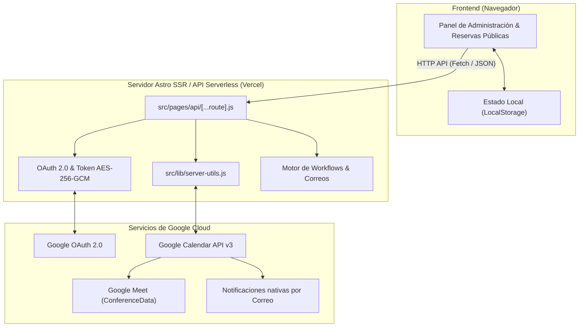

# Reuniones - Clon Completo de Calendly con Google Calendar API

> Sistema completo de programación de citas, gestión de tipos de reunión y reservas públicas en tiempo real, integrado de forma nativa y bidireccional con **Google Calendar API v3** y **Google Meet**.

---

## 📋 Tabla de Contenidos

- [Descripción General](#-descripción-general)
- [Funcionalidades Principales](#-funcionalidades-principales)
- [Cómo fue Recuperado y Reconstruido con REA](#-cómo-fue-recuperado-y-reconstruido-con-rea)
- [Arquitectura del Sistema](#-arquitectura-del-sistema)
- [Flujo de Google Calendar y Notificaciones por Correo](#-flujo-de-google-calendar-y-notificaciones-por-correo)
- [Estructura del Repositorio](#-estructura-del-repositorio)
- [Variables de Entorno (`.env`)](#-variables-de-entorno-env)
- [Instalación y Ejecución Local](#-instalación-y-ejecución-local)
- [Despliegue en Producción (Vercel)](#-despliegue-en-producción-vercel)

---

## 🚀 Descripción General

**Reuniones** es una plataforma de agendamiento de citas diseñada como una alternativa ligera, moderna y completamente autónoma a plataformas como Calendly o Cal.com. 

Permite a profesionales y empresas compartir un enlace público personalizado para que clientes e invitados elijan un horario disponible según la agenda real del anfitrión, bloqueando el horario inmediatamente en Google Calendar y generando una reunión de Google Meet sin intervención manual.

---

## 🌟 Funcionalidades Principales

### 1. Gestión de Tipos de Reunión (Event Types)
- **Modalidades soportadas:** Citas individuales (1 a 1), Sesiones grupales (talleres/webinars), Reuniones colectivas y Round Robin.
- **Personalización total:** Duración (15, 30, 45, 60 min o personalizada), color identificador, descripción, slug de enlace personalizado y ubicación (Google Meet, Presencial, Teléfono).
- **Editor en tiempo real:** Creación, edición, duplicación y eliminación con persistencia en almacenamiento local y sincronización en servidor.

### 2. Página Pública de Reservas (Estilo Calendly)
- **Perfil público del anfitrión:** Ruta limpia accesible vía `#/user/:slug` con listado de todos los tipos de eventos activos.
- **Split-View interactivo:** 
  - Columna izquierda: Información del anfitrión, avatar, duración y detalles de la sesión.
  - Columna derecha: Calendario mensual interactivo con cálculo dinámico de días laborables y franjas horarias disponibles.
- **Soporte de Zonas Horarias:** Detección automática de la zona horaria del visitante con selector para conversión instantánea de horarios.
- **Formulario de reserva:** Captura de nombre, correo electrónico, teléfono, notas de preparación y **soporte para múltiples invitados adicionales**.

### 3. Sincronización Bidireccional con Google Calendar API v3
- **Google OAuth 2.0:** Inicio de sesión seguro con consentimiento offline y actualización automática de tokens (`access_token` y `refresh_token`).
- **Bloqueo de horarios en tiempo real:** Lectura de eventos existentes en el calendario del anfitrión para ocultar automáticamente horarios ocupados.
- **Inserción directa de eventos:** Creación de eventos oficiales con `conferenceDataVersion=1` para generar enlaces automáticos de **Google Meet**.
- **Gestión de cancelaciones:** Al cancelar o borrar una cita desde la app, se elimina el evento de Google Calendar y se libera automáticamente el espacio.

### 4. Notificaciones Nativas por Correo
- **Invitado principal e invitados adicionales:** Google Calendar despacha de forma nativa (`sendUpdates=all`) invitaciones oficiales con botones de confirmación (*Sí / Quizás / No*) y el enlace de Meet a todas las direcciones especificadas.
- **Descarga de archivos `.ics`:** Generación y descarga directa de archivos de calendario estándar compatibles con Apple Mail, Outlook y Google Calendar.
- **Motor de Workflows complementarios:** Soporte integrado con Resend API y Gmail SMTP (Nodemailer) para despachar avisos con diseño personalizado tanto al anfitrión como a los asistentes.

---

## 🔍 Cómo fue Recuperado y Reconstruido con REA

El proyecto fue analizado, recuperado y estructurado utilizando **REA (Reverse Engineer Anything)**, una suite avanzada de herramientas de ingeniería inversa y análisis de software:

### 1. Análisis del Bundle y Estructuras Originales
- **Inspección de artefactos web:** Mediante las capacidades de REA para analizar bundles JavaScript y aplicaciones web (`analyze_web_bundle`, trazado de módulos e inferencia de interfaces), se examinó la arquitectura interna de los componentes de reserva y flujos de usuario originales de Calendly.
- **Reconstrucción de esquemas:** Se extrajeron y tiparon las estructuras de datos esenciales:
  - Definición de tipos de evento (`EventTypes`).
  - Modelo de citas agendadas (`ScheduledMeetings`).
  - Estados de conexión de calendario y configuraciones de sincronización (`SyncConfig`).

### 2. Extracción de Lógica de Negocio y Algoritmos
- **Motor de cálculo de slots libres/ocupados:** Se recuperó el algoritmo que transforma la disponibilidad semanal del anfitrión y los eventos del calendario en intervalos disponibles de 15, 30 o 60 minutos, respetando zonas horarias y márgenes (*buffers*).
- **Normalización de fechas con desfase horario:** Se implementaron funciones robustas (`buildLocalDateTimeWithOffset` y `normalizeDateTimeWithOffset`) para evitar el error habitual de cambio de día al convertir entre UTC y zonas horarias locales (ej. `America/Santiago`, `America/Argentina/Buenos_Aires`).

### 3. Reescritura Limpia y Desacoplamiento
- Se eliminaron rastros de dependencias propietarias o librerías pesadas, reemplazándolas por **Vanilla JavaScript modular** y **CSS nativo con variables de diseño (Design Tokens)**.
- Se implementó una arquitectura híbrida moderna con **Astro 5** para renderizado del lado del servidor (SSR) en entornos Serverless (Vercel), con cifrado **AES-256-GCM** para la seguridad de tokens en tránsito.

---

## 🏗️ Arquitectura del Sistema



---

## ✉️ Flujo de Google Calendar y Notificaciones por Correo

### Creación de una Cita con Múltiples Invitados
1. El usuario selecciona día y hora en la página pública del anfitrión.
2. Ingresa su nombre y correo, y presiona **«+ Añadir invitados»** para sumar colegas o participantes adicionales (`invitado1@correo.com, invitado2@correo.com`).
3. El frontend envía la solicitud a `POST /api/calendar/book`.
4. El backend construye la petición a Google Calendar API:
   - **URL:** `POST https://www.googleapis.com/calendar/v3/calendars/primary/events?conferenceDataVersion=1&sendUpdates=all`
   - **Attendees:**
     ```json
     [
       { "email": "invitado_principal@ejemplo.com", "displayName": "Invitado" },
       { "email": "colega@ejemplo.com", "displayName": "Invitado adicional", "responseStatus": "needsAction" },
       { "email": "anfitrion@correo.com", "displayName": "Anfitrión" }
     ]
     ```
   - **ConferenceData:** Genera automáticamente el enlace único de Google Meet.
5. **Google Calendar despacha de forma nativa las invitaciones por email** a todos los asistentes.

### ¿Cómo recibir aviso en la casilla del Anfitrión?
Google Calendar por diseño suprime el envío de "invitación" al dueño del calendario porque asume que el creador ya conoce el evento. Para que al anfitrión le llegue un aviso por correo:
- **Opción Nativa de Google:** En [Google Calendar](https://calendar.google.com) → *Configuración de mi calendario* → *Otras notificaciones* → Activar **Eventos nuevos: Correo electrónico**.
- **Opción de Flujos de Trabajo:** Configurar `RESEND_API_KEY` o `SMTP_USER`/`SMTP_PASS` en Vercel para que el backend despache un correo con formato específico al anfitrión: *"🔔 ¡Nueva reserva de [Invitado]!"*.

---

## 📁 Estructura del Repositorio

```text
calendario/
├── public/
│   ├── app.js               # Lógica interactiva del cliente (Vanilla JS)
│   ├── index.css            # Sistema de estilos y tokens de diseño
│   └── favicon.svg          # Isotipo de la aplicación
├── src/
│   ├── components/
│   │   └── App.astro        # Componente principal Astro con todo el DOM
│   ├── layouts/
│   │   └── Layout.astro     # Layout base HTML5
│   ├── lib/
│   │   ├── server-utils.js  # Lógica central: Google Calendar, ICS, SMTP, Resend
│   │   └── legacy-api-handler.js # Handler HTTP compatible con Node.js puro
│   └── pages/
│       ├── index.astro      # Punto de entrada de la SPA
│       └── api/
│           └── [...route].js # API Router REST (Auth, Citas, Sync, Workflows)
├── .env.example             # Plantilla documentada de variables de entorno
├── astro.config.mjs         # Configuración de Astro con adaptador @astrojs/vercel
├── package.json             # Dependencias del proyecto
└── server.js                # Servidor Node.js standalone opcional
```

---

## ⚙️ Variables de Entorno (`.env`)

Crea un archivo `.env` en la raíz (puedes guiarte con `.env.example`):

```env
# ------------------------------------------------------------------------------
# 1. Google Calendar API & OAuth 2.0
# ------------------------------------------------------------------------------
GOOGLE_CLIENT_ID=tu_cliente_id.apps.googleusercontent.com
GOOGLE_CLIENT_SECRET=tu_cliente_secreto
GOOGLE_REDIRECT_URI=https://tu-dominio.vercel.app/api/auth/google/callback
GOOGLE_SCOPES=openid email profile https://www.googleapis.com/auth/calendar.events https://www.googleapis.com/auth/calendar

# ------------------------------------------------------------------------------
# 2. Notificaciones complementarias por Email (Opcional)
# ------------------------------------------------------------------------------
# Opción A: Resend API (Recomendada para Serverless)
RESEND_API_KEY=re_123456789...
EMAIL_FROM=Reuniones <onboarding@resend.dev>

# Opción B: Gmail SMTP con Contraseña de Aplicación (16 caracteres)
# SMTP_USER=tu_correo@gmail.com
# SMTP_PASS=tu_contrasena_de_aplicacion
# SMTP_FROM="Reuniones" <tu_correo@gmail.com>

# ------------------------------------------------------------------------------
# 3. Sesión y Servidor
# ------------------------------------------------------------------------------
SESSION_SECRET=clave_secreta_para_cifrado_aes_256_gcm
APP_URL=https://tu-dominio.vercel.app
PORT=3000
```

---

## 💻 Instalación y Ejecución Local

1. **Clonar el repositorio:**
   ```bash
   git clone https://github.com/dracero/calendario.git
   cd calendario
   ```

2. **Instalar dependencias:**
   ```bash
   npm install
   ```

3. **Iniciar el servidor de desarrollo:**
   ```bash
   npm run dev
   ```
   La aplicación estará disponible en `http://localhost:4321` (o el puerto indicado por Astro).

4. **Compilar para producción:**
   ```bash
   npm run build
   ```

---

## ☁️ Despliegue en Producción (Vercel)

El proyecto está preconfigurado con el adaptador oficial `@astrojs/vercel/serverless`:

1. Conecta tu repositorio de GitHub en el panel de **[Vercel](https://vercel.com)**.
2. En la configuración del proyecto, agrega las variables de entorno detalladas en la sección anterior (`GOOGLE_CLIENT_ID`, `GOOGLE_CLIENT_SECRET`, etc.).
3. Asegúrate de registrar la URI de redirección de producción en tu consola de Google Cloud:
   ```text
   https://tu-proyecto.vercel.app/api/auth/google/callback
   ```
4. Cada vez que hagas `git push origin main`, Vercel compilará y desplegará automáticamente la última versión.
